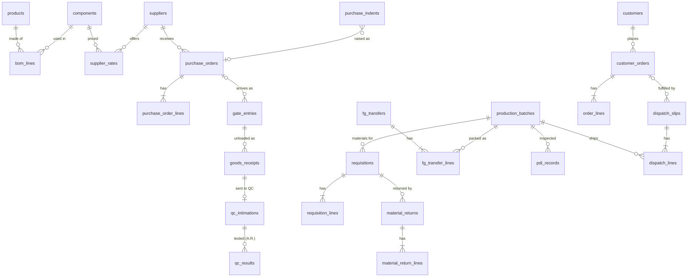

# Database design — normalized schema

Status: **implemented** (migrations 3–4 in `server/src/schema.ts`, data conversion in
`server/src/legacy.ts`, reads/writes in `server/src/repository.ts`). Replaced the earlier
"one JSON document per row" storage; the conversion reconciled document counts, store stock,
FG stock, PO and order balances exactly before the old tables were dropped.

## 0. As built — differences from the proposal below

| Topic | Decision taken |
|---|---|
| Renames | **Consistent everywhere** (owner's rule): documents hold keys only; no name snapshots at all. `npm run master -- rename-…` changes one row. |
| Supplier on a gate entry | Always a `supplier_id`. A supplier not yet on file is recorded automatically with `approved = 0` (no rates); the price master lists approved suppliers only. |
| Customers | Created on the first order/dispatch that names them, found again by a keyed hash of the name (the name itself is encrypted). The address is master data: a document can fill it in when missing, not overwrite it. No ship-to snapshot. |
| Batches, locations | Created on first use, inside the same transaction as the document. |
| Line totals | Generated columns (`total_qty`), so a stored total can never disagree with boxes × per box (+ loose). |
| Status | Never stored: from `issued_at`, `received_on`, `approved_by`, `po_no`, `gate_out_at`, and the `v_grn_qc_status` view (latest A.R. result). |
| Privileges | Runtime account: SELECT/INSERT/UPDATE on registers, **no DELETE** unless `ALLOW_DEMO_RESET=true` at setup; masters read-only; audit log and snapshots append-only. |
| JSON | Only on the way out of the API: `loadState` joins the tables into the shape the screens use. Snapshots (backups) are stored as one encrypted blob by design. |
| Masters in the browser | Served by `GET /api/masters` after login (BOM only to roles that raise requisitions); no longer compiled into the frontend bundle. |
| Concurrency (migration 5) | Every register document carries `row_version` = the change number of its last change (also bumped when a value shown on it changes elsewhere, e.g. a QC result on its GRN). Each action sends the change number its screen was built from; the server refuses it (409 `STALE`) if a document it changes moved on since. |
| Locking | No global lock. Each action locks only its documents, the stock of the components it draws on, or the FG batch it ships/inspects (MySQL named locks, taken in sorted order — no deadlock), then reads only the rows its rule needs (indexed slices). Unrelated actions run in parallel. |
| Numbering | `document_sequences`: one row per series, locked only while one document of that series is created; a rolled-back action returns its number (no gaps). |
| Sync | The change number is assigned as the last step before COMMIT, so numbers follow commit order. Screens poll `GET /api/version` and fetch `GET /api/changes?since=N` (only changed documents); resets, restores, renames and customer edits request a full reload (`resync_version`). |
| Stage locks (migration 6) | `server/src/stageLocks.ts` generates BEFORE UPDATE / BEFORE DELETE triggers from the live table definitions: everything is locked by default except bookkeeping columns; per table, set-once columns (e.g. `approved_by`, `gate_out_at`, `qty_issued`) and stage-bound columns (GRN qty until sent to QC) are listed explicitly. Deletes only inside the protected reset (`@flow_reset` on that connection). Audit log and snapshots are append-only for every account. Re-installed on each `db:setup`. |
| Still to do | First load still sends the full history a role may see, and stock/progress figures are summed in the browser from it; for many years of data, add server-side stock views and paged history. Per-role column allow-lists. |

## 1. Principles

1. **Each fact is stored once.** The document number is the primary key and appears nowhere
   else in the row. Dates are `DATE`/`DATETIME`, quantities `INT`, money `DECIMAL`.
2. **References, not copies.** A GRN points at its gate entry; it does not repeat the supplier,
   invoice and PO. A QC slip points at its GRN; it does not repeat the quantity.
3. **Derived values are computed, never stored.** QC status, requisition/transfer/PO status,
   stock, PO pending and order balance come from queries (database views), so they cannot
   disagree with the documents they come from.
4. **Intentional copies are named as such.** Where a document must keep what was true *on that
   day* (the rate agreed on a PO, the ship-to address on a dispatch), the column says so:
   `rate_agreed`, `ship_to_address_enc`.
5. **The database enforces integrity too:** foreign keys, `CHECK` constraints, enums, unique
   keys — not only the application.
6. **Registers are append-only in production.** The app account gets no `DELETE` on business
   tables; a wrong entry is corrected by a cancelling/reversing document with a reason (planned).
7. **Encrypt only what is sensitive,** column by column (AES-256-GCM, `_enc` suffix, `VARBINARY`).

## 2. Findings in the current data that shape the design

| Finding | Consequence |
|---|---|
| FG codes are **not unique** (`SS-316`, `LL-120` appear twice) and 5 products have **no FG code** | Products get a surrogate `id`; `name` is the unique key; `fg_code` is an ordinary column |
| Gate entries reference POs raised **before** the system (`26SEV118`) | `po_no` is a nullable FK; a separate `external_po_ref` keeps old/paper PO numbers |
| GRN supplier / invoice / PO always equal the gate entry's | Removed from the GRN — joined from the gate entry |
| QC intimation qty always equals the GRN qty (kept in sync by code today) | Removed from the QC slip — read from the GRN; the sync code disappears |
| GRN `qcStatus` repeats the latest A.R. record | Removed — computed from the latest result |
| Requisition `returnQty` repeats the MRN lines | Removed — computed |
| Customers are typed again on every order and dispatch | New `customers` master; documents reference it |
| A batch (e.g. `LL112-B01`) is matched by text across requisition, FG transfer, PDI and dispatch | New `production_batches` table; all four reference it |
| Locations are free text (`Store — Floor 1`, `FG Godown A`) | New `locations` master (client asked for place-wise stock) |

## 3. Entity overview

## 4. Tables

Common to every business table (omitted below): `created_by INT FK users`, `created_at DATETIME(3)`.
`PK` = primary key, `FK` = foreign key, `UQ` = unique, `enc` = encrypted.

### 4.1 Masters

**components** — the PMS list
| column | type | rule |
|---|---|---|
| code | VARCHAR(16) | PK (`PMS0001`) |
| name | VARCHAR(160) | NOT NULL |
| type | VARCHAR(40) | |
| active | BOOL | default true |

**products**
| column | type | rule |
|---|---|---|
| id | INT | PK |
| name | VARCHAR(160) | UQ |
| fg_code | VARCHAR(80) | not unique (see findings) |
| vendor | ENUM('China','Domestic','') | |
| box_size | INT NULL | units per box |

**bom_lines** — PK (product_id, component_code)
| column | type | rule |
|---|---|---|
| product_id | INT | FK products |
| component_code | VARCHAR(16) | FK components |
| per_100 | DECIMAL(12,6) | CHECK > 0 — quantity per 100 finished units |

**suppliers** — id PK, name UQ, city, active
**supplier_rates** — PK (supplier_id, component_code); `rate_enc` (fixed rate, encrypted)
**locations** — id PK, name UQ, kind ENUM('STORE','FG')
**customers** — id PK, `name_enc`, `name_hash` UQ (keyed hash, for duplicate detection/search on an encrypted name), `address_enc`, active
**stock_settings** — component_code PK FK, opening_qty INT CHECK ≥ 0, min_level INT NULL CHECK ≥ 0

### 4.2 Purchase

**purchase_indents**
| column | type | rule |
|---|---|---|
| indent_no | VARCHAR(20) | PK (`IND-0001`) |
| indent_date | DATE | |
| component_code | VARCHAR(16) | FK |
| qty | INT | CHECK > 0 |
| reason | VARCHAR(200) | |
| po_no | VARCHAR(20) NULL | FK purchase_orders — *status `PO_RAISED` = this is set* |

**purchase_orders**
| column | type | rule |
|---|---|---|
| po_no | VARCHAR(20) | PK (`26SEV231`) |
| po_date | DATE | |
| supplier_id | INT | FK |
| expected_date | DATE NULL | |
| approved_by | INT NULL | FK users — *status `APPROVED` = this is set* |
| approved_at | DATETIME NULL | |

**purchase_order_lines** — PK (po_no, line_no)
| column | type | rule |
|---|---|---|
| component_code | VARCHAR(16) | FK |
| qty | INT | CHECK > 0 |
| rate_agreed_enc | VARBINARY | *intentional copy:* the rate on the day of the PO |

### 4.3 Inward and QC

**gate_entries**
| column | type | rule |
|---|---|---|
| gate_entry_no | VARCHAR(20) | PK (`GE-0001`) |
| entry_date | DATE | |
| supplier_id | INT NULL | FK — when the supplier is on the approved list |
| supplier_name | VARCHAR(120) | *intentional:* as written in the register (unlisted suppliers arrive too) |
| po_no | VARCHAR(20) NULL | FK purchase_orders |
| external_po_ref | VARCHAR(40) NULL | PO numbers from before the system / on paper |
| product_desc | VARCHAR(300) | |
| invoice_no, invoice_date, invoice_qty | | supplier's invoice |
| transport_name | VARCHAR(120) | |
| lr_no_enc, vehicle_no_enc | VARBINARY | |
| time_in, time_out | TIME NULL | |
| driver_signed | BOOL | |
| remark | VARCHAR(500) | |

**goods_receipts** (GRN — one row per component received, as on the client's sheet)
| column | type | rule |
|---|---|---|
| grn_no | VARCHAR(20) | PK (`GR0001`) |
| gate_entry_no | VARCHAR(20) | FK NOT NULL — supplier, invoice, PO come from here |
| component_code | VARCHAR(16) | FK — name and type come from the master |
| brand_name | VARCHAR(60) | |
| received_date | DATE | |
| po_qty | INT NULL | |
| qty_per_box, total_boxes | INT NULL | CHECK > 0 |
| total_qty | INT | CHECK > 0 |
| location_id | INT NULL | FK locations |
| barcoded | BOOL | |
| remark_store | VARCHAR(500) | |

**qc_intimations**
| column | type | rule |
|---|---|---|
| intimation_no | VARCHAR(20) | PK (`QCI-0001`) |
| grn_no | VARCHAR(20) | FK, **UQ** — one slip per GRN; product, qty, supplier come from the GRN |
| issued_at | DATETIME | date + time of issue |
| batch_no | VARCHAR(40) | supplier's lot number |
| mfg_date, expiry_date | DATE NULL | |
| remark | VARCHAR(500) | |

**qc_results** (A.R. records — history kept; the latest decides)
| column | type | rule |
|---|---|---|
| ar_no | VARCHAR(20) | PK (`AR-0001`) |
| intimation_no | VARCHAR(20) | FK |
| decided_on | DATE | |
| status | ENUM('APPROVED','HOLD','REJECTED') | |
| remark | VARCHAR(500) | |

### 4.4 Production

**production_batches** — id PK, product_id FK, batch_no VARCHAR(40), UQ (product_id, batch_no)

**requisitions**
| column | type | rule |
|---|---|---|
| req_no | VARCHAR(20) | PK (`REQ-0001`) |
| req_date | DATE | |
| department | VARCHAR(40) | |
| batch_id | INT NULL | FK — gives the product too |
| packing_sign | VARCHAR(80) | typed name, as on paper |
| issued_at | DATETIME NULL | *status `ISSUED` = this is set* |
| issued_by | INT NULL | FK users — the real account |
| store_sign | VARCHAR(80) | |

**requisition_lines** — PK (req_no, line_no); component_code FK; unit; qty_required CHECK > 0; qty_issued NULL CHECK ≥ 0; remark

**material_returns** — mrn_no PK, mrn_date, req_no FK, sign, remark
**material_return_lines** — PK (mrn_no, line_no); component_code FK; qty CHECK > 0

### 4.5 Finished goods

**fg_transfers** — transfer_no PK, transfer_date, submitted_by; received_on DATE NULL (*status `RECEIVED` = set*), checked_by, received_by FK users, location_id FK

**fg_transfer_lines** — PK (transfer_no, line_no)
| column | type | rule |
|---|---|---|
| batch_id | INT | FK — product and SKU come from here |
| mfg_month | CHAR(7) | `mm-yyyy` |
| qty_per_box | INT | CHECK > 0 |
| total_boxes, loose_qty | INT | CHECK ≥ 0 |
| total_qty | INT | **generated:** boxes × per box + loose |
| remark | VARCHAR(500) | |

**pdi_records** — pdi_no PK, pdi_date, batch_id FK, status ENUM('PASSED','FAILED'), remark, inspected_by FK users (history kept; the latest decides)

### 4.6 Sales and dispatch

**customer_orders** — order_no PK (`WO-0001`), order_date, customer_id FK, cust_po_no_enc, delivery_date NULL, remark
**order_lines** — PK (order_no, line_no); product_id FK; qty CHECK > 0

**dispatch_slips**
| column | type | rule |
|---|---|---|
| dispatch_no | VARCHAR(20) | PK (`DPS-0001`) |
| dispatch_date | DATE | |
| order_no | VARCHAR(20) NULL | FK |
| customer_id | INT | FK |
| ship_to_address_enc | VARBINARY | *intentional copy:* where this consignment went |
| dispatch_sign | VARCHAR(80) | |
| invoice_no_enc, invoice_date | | filled by Accounts |
| gate_out_at | DATETIME NULL | *replaces the gateOut flag + time* |
| security_sign | VARCHAR(80) | |
| remark | VARCHAR(500) | |

**dispatch_lines** — PK (dispatch_no, line_no); batch_id FK; qty_per_box; total_boxes CHECK > 0; total_qty **generated**

### 4.7 System (already relational today — unchanged)

`users`, `sessions`, `audit_log` (append-only), `state_snapshots`, `schema_migrations`, plus
`document_sequences` (series PK, last_no) so numbers never repeat even if a document is ever removed.

## 5. Derived values → database views

| View | Replaces | Definition (summary) |
|---|---|---|
| `v_grn_qc_status` | `GrnLine.qcStatus` | latest `qc_results.status` via the intimation; `UNDER_TEST` if none |
| `v_pm_stock` | `derivePmStock` | opening + approved receipts − issued + returned; under-test / hold / rejected separately |
| `v_fg_stock` | `deriveFgStock` | received transfer lines − dispatch lines, per batch; latest PDI |
| `v_po_progress` | `derivePoProgress` | ordered − received (GRNs via gate entries carrying that PO) |
| `v_order_progress` | `deriveOrderProgress` | ordered − dispatched per product |
| status columns | `status` fields | from `issued_at`, `received_on`, `approved_at`, `po_no`, `gate_out_at` |

The same rules stay in `src/flow/logic.ts` for the guards; tests check that the views and the
TypeScript functions give identical figures on the demo data.

## 6. What was redundant and where it goes

| Today (inside the JSON) | In the new schema |
|---|---|
| `doc_no`, `status`, `doc_date`, `ref` columns **and** the same values in JSON | stored once, as typed columns |
| GRN `componentName`, `type` | join `components` |
| GRN `supplierName`, `invoiceNo`, `poNo` | join `gate_entries` |
| GRN `qcStatus` | `v_grn_qc_status` |
| QC slip `productName`, `code`, `supplierName`, `invoiceNo`, `totalQty`, `totalBox` | join `goods_receipts` |
| Requisition line `materialName`, `returnQty`; requisition `status`, `productName` | join master / computed / from `issued_at` / via batch |
| FG transfer line `productCode`, `productName`, `sku`, `batchNo` | `batch_id` → batch → product |
| FG transfer `status`, dispatch `gateOut` | from `received_on` / `gate_out_at` |
| Order/dispatch `partyName`, `partyAddress` | `customers` (+ ship-to snapshot on dispatch) |
| Dispatch line `productName`, `productCode`, `batchNo` | `batch_id` |
| PO line `componentName`; PO `status`; indent `status` | join / from `approved_at` / from `po_no` |
| PDI `productName`, `batchNo` | `batch_id` |

## 7. Migration plan

**Phase 1 — new storage, same rules (no change to business logic or screens)**
1. Create the tables above; load masters from `bom.json` / `inventory.json` / suppliers.
2. Repository *reads* the tables (with joins) and builds the same `FlowState` the reducers use.
3. Repository *writes* the reducer's result back row by row, and **verifies every copied field
   matches its source** (e.g. a GRN's supplier = its gate entry's) — a mismatch aborts the
   transaction, so hidden inconsistencies surface instead of being stored.
4. One-off migration script: current JSON tables → new tables, with a count and stock
   reconciliation report; old tables kept read-only until signed off.

**Phase 2 — scale and strict views**
5. Actions read only the rows they need instead of the whole database.
6. Each role receives server-computed screen data (from the views) and only its allowed columns.
7. Masters (BOM) served by the API behind login instead of being compiled into the frontend.

## 8. Decisions needed

| # | Question | Recommendation |
|---|---|---|
| 1 | If a component or product is **renamed** in the master, should old GRNs/slips show the old name or the new one? | New name (join). The code identifies the item; renames are rare. Add a snapshot column only if the client needs the printed-at-the-time name. |
| 2 | Introduce a **customers** master (no retyping, consistent spelling)? | Yes |
| 3 | Introduce **production batches** as their own table? | Yes — it is the thread of traceability |
| 4 | Introduce a **locations** master now? | Yes, as a list; location-wise stock quantities can come later |
| 5 | Encrypt **supplier rates / PO rates** (stops SQL sums of purchase value) or keep them plain with access control? | Encrypt; purchase value reports computed in the app for Purchase/Admin |
| 6 | **No DELETE** on business tables in production; corrections by cancel/reverse documents | Yes |
| 7 | How much **history** should each role see on screen (e.g. Security: open dispatches only)? | Open items + last 90 days; older via search/export for authorised roles |
